  

  
  
  
  

  

## What I do

I sit between the people who sell and the people who build. About two years across product, marketing, GTM and ops at a B2B SaaS startup, and now I build the automation that work needs: CRM workflows, enrichment, account research, outbound.

## What I'm building

<table>
  <tr>
    <td width="33%" valign="top">
      <h3>Account Copilot</h3>
      A GTM/RevOps copilot on Supabase + HubSpot that turns raw account data into something a seller can act on.  
      <a href="https://copilot.f1rstword.com">Live</a>
    </td>
    <td width="33%" valign="top">
      <h3>HubSpot GTM automation</h3>
      Headless automation on top of HubSpot, no UI. Node, TypeScript and Supabase doing the boring parts reliably.  
    </td>
    <td width="33%" valign="top">
      <h3>Firstword</h3>
      A small growth advisory practice for early-stage B2B SaaS founders: LinkedIn outbound and lead gen.  
      <a href="https://first-word.netlify.app">Site</a>
    </td>
  </tr>
</table>

<!-- TODO: add one real result per card (replies booked, hours saved, records processed). -->

## Stack

  
  
  
  
  

## Writing

I write as a generalist under **Growth, Honestly**: products, marketing and startup life, without the performance.

<!-- TODO: latest 2-3 posts, or auto-update with the blog-post-workflow action. -->

## Activity

  <picture>
    <source media="(prefers-color-scheme: dark)" srcset="https://raw.githubusercontent.com/rudrat04/rudrat04/output/snake-dark.svg" />
    
  </picture>

## Open to

Full-time GTM engineering, growth or founder's-office roles, and a few advisory clients. Easiest way in is [LinkedIn](https://www.linkedin.com/in/rudra-trivedi-t04).
