  

  
  
  

  

## How I can help

<table>
  <tr>
    <td width="50%" valign="top">
      <h3>Sales, RevOps &amp; GTM architecture</h3>
      A review of how you sell today, a clear operating design, and automation for lead scoring, account finding, pre-meeting briefs and CRM upkeep.
    </td>
    <td width="50%" valign="top">
      <h3>Product marketing</h3>
      Messaging, positioning and go-to-market plans that sales can actually use.
    </td>
  </tr>
  <tr>
    <td width="50%" valign="top">
      <h3>Website creation</h3>
      Simple, mobile-friendly sites, built and launched end to end.
    </td>
    <td width="50%" valign="top">
      <h3>Industry automations</h3>
      Ready-made automations for the daily admin: lead alerts, invoicing, status updates.
    </td>
  </tr>
</table>

## Things I've built &amp; fixed

<table>
  <tr>
    <td width="33%" valign="top">
      <h1 align="center">100+</h1>
      <b>qualified B2B demos booked</b> 
      Outbound turnaround at mple.ai: ICP mapping, personalised messaging and an AI reply brief engine. 30% reply rate over 4 months on LinkedIn.
    </td>
    <td width="33%" valign="top">
      <h1 align="center">30 min</h1>
      <b>research saved per lead</b> 
      An automated brief that lands with sales on every LinkedIn reply, so nobody starts a call cold.
    </td>
    <td width="33%" valign="top">
      <h1 align="center">7 → 2 days</h1>
      <b>client onboarding</b> 
      A 70% cut in onboarding time at mple.ai, with feature activation up 25% and product adoption up 30%.
    </td>
  </tr>
</table>

**[Account Copilot](https://copilot.f1rstword.com)** is an open-source account copilot on Supabase and HubSpot. It scores a new enquiry in about 10 seconds. Outreach stays manual, and nothing is sent to a prospect automatically.

## Stack

  
  
  
  
  

## Where I've been

Two years in B2B SaaS at mple.ai, from Product Manager to Founder's Office Associate, across product, growth, marketing and ops. I also led audit readiness for ISO 27001, SOC 2 and GDPR with Scrut.io. B.E. in AI and Machine Learning. I didn't study growth, I got thrown into it.

I write about it as a generalist under **Growth, Honestly**: products, marketing and startup life, without the performance.

<!-- TODO: add links to your latest 2-3 posts here. -->

## Activity

  <picture>
    <source media="(prefers-color-scheme: dark)" srcset="https://raw.githubusercontent.com/rudrat04/rudrat04/output/snake-dark.svg" />
    
  </picture>

  <b>Got something that needs fixing?</b> <a href="https://f1rstword.com">Let's work on it together →</a>

